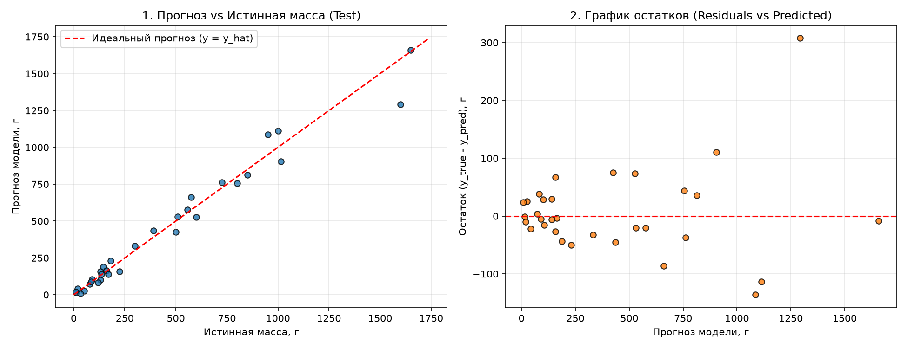
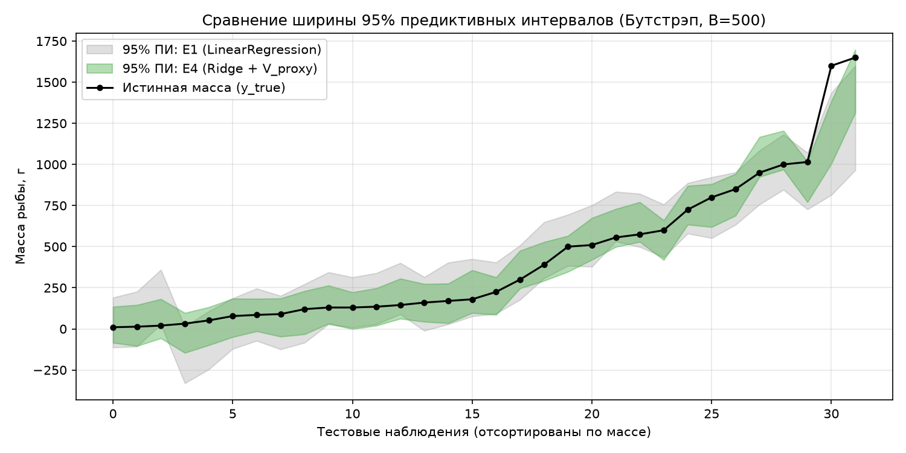

# Лабораторная работа №2. Платформа FishGrow: прогностическая модель и MLflow

## 1. Постановка задачи и методика эксперимента

Цель работы — построить воспроизводимый конвейер прогнозирования массы рыбы (`Weight`) по её морфометрическим измерениям и виду (`Species`), сравнить линейные и нелинейные модели по метрикам $MSE$, $MAE$ и $R^2$, а также зафиксировать запуски в MLflow.

### 1.1. Подготовка данных и протокол разбиения
* **Источник данных:** Очищенный датасет из ЛР №1 (`data/processed/fish_checked.csv`, $N = 158$). Запись с физически невозможным значением `Weight = 0.0` (вид `Roach`) удалена; три статистических выброса крупных особей `Pike` (1550–1650 г) сохранены для поддержания обобщающей способности модели.
* **Заморозка тестовой выборки:** Разбиение на обучающую ($80\%$, 126 объектов) и отложенную тестовую ($20\%$, 32 объекта) выборки выполнено до подбора признаков и гиперпараметров (`random_state=42`, стратификация по `Species`).
* **Конвейер предобработки:** Все преобразования объединены в единый `Pipeline` с `ColumnTransformer`:
  * Числовые признаки (`Length1`, `Length2`, `Length3`, `Height`, `Width`): заполнение пропусков медианой (`SimpleImputer`) + стандартизация (`StandardScaler`).
  * Категориальный признак (`Species`): заполнение модой + `OneHotEncoder(handle_unknown="ignore")`.
  * Настройка параметров масштабирования и импьютации выполняется строго внутри каждого фолда 5-блочной перекрёстной проверки (`KFold(n_splits=5, shuffle=True, random_state=42)`), что исключает утечку данных.

---

## 2. Сводная таблица экспериментов (E0–E4)

Все эксперименты зарегистрированы в локальном хранилище MLflow (`sqlite:///mlflow.db`, эксперимент `FishGrow_Regression`).

| Эксперимент | Модель и конфигурация | CV $R^2$ (mean) | Test $MSE$ | Test $MAE$, г | Test $R^2$ |
| :--- | :--- | :---: | :---: | :---: | :---: |
| **E0** | `DummyRegressor(strategy="mean")` (наивный базовый) | -0.0473 | 193891.49 | 350.79 | -0.0075 |
| **E1** | `LinearRegression` (исходная шкала целевой переменной) | 0.9065 | 13653.05 | 75.47 | 0.9291 |
| **E1-log** | `LinearRegression` + `log(1 + y)` (`TransformedTargetRegressor`) | 0.8809 | 107229.64 | 111.10 | 0.4428 |
| **E2** | `Ridge` (подбор $\alpha \in [0.01 \dots 100]$ по CV) | 0.9136 | 15961.88 | 76.37 | 0.9171 |
| **E3** | `RandomForestRegressor` (сетка из 12 конфигураций по CV) | 0.9478 | 6996.84 | 48.67 | 0.9636 |
| **E4** | `Ridge` + производный признак $V_{proxy} = Length3 \times Height \times Width$ | **0.9602** | **5638.63** | **48.37** | **0.9707** |

### 2.1. Ключевые выводы по экспериментам
1. **Сравнение с бейзлайном (E0):** Наивный прогноз среднего даёт $R^2 = -0.0075$ и среднюю ошибку $350.79\text{ г}$. Все обученные модели многократно превосходят константный ориентир.
2. **Эффект логарифмирования (E1 vs E1-log):** Линейная модель на исходной шкале достигает $R^2 = 0.9291$, тогда как обучение в шкале $\log(1+y)$ с обратным преобразованием $\exp(\hat{z})-1$ резко ухудшает метрики в граммах ($R^2 = 0.4428$, $MSE = 107229.64$). Причина — экспоненциальное усиление небольших ошибок на правом хвосте распределения (крупных особях `Pike` и `Bream`) при возврате в исходную шкалу.
3. **Регуляризация и масштабирование (E2):** Признаки длины (`Length1`, `Length2`, `Length3`) имеют парную корреляцию $r > 0.99$. Без стандартизации (`StandardScaler`) веса линейной модели несопоставимы между собой и L2-штраф гребневой регрессии неравномерно сжимает коэффициенты признаков с разным масштабом. После стандартизации `Ridge` стабилизирует веса и повышает качество на кросс-валидации ($CV\ R^2 = 0.9136$ против $0.9065$ у МНК).
4. **Нелинейный ансамбль (E3):** Случайный лес улавливает кубическую зависимость массы от линейных размеров без ручной генерации признаков ($Test\ R^2 = 0.9636$, $MAE = 48.67\text{ г}$), однако ограничен в экстраполяции на крайних значениях массы.
5. **Инженерия признаков (E4):** Добавление физически обоснованного признака прокси-объёма $V_{proxy} = Length3 \times Height \times Width$ линеаризует зависимость массы от габаритов. Хотя $V_{proxy}$ усиливает мультиколлинеарность с исходными линейными размерами, L2-регуляризация в `Ridge` успешно справляется с корреляцией признаков и выводит модель на лучший результат среди всех экспериментов ($Test\ R^2 = 0.9707$, $MAE = 48.37\text{ г}$, $MSE = 5638.63$).

---

## 3. Анализ ошибок лучшей модели (`E4_Ridge_With_Volume`)

### 3.1. Систематические зоны ошибки и гетероскедастичность
1. **Рост разброса остатков с увеличением массы:** На графике `Residuals vs Predicted` чётко видна гетероскедастичность — для мелких рыб (до $250\text{ г}$) остатки лежат в узком коридоре $\pm 40\text{ г}$, тогда как для крупных особей ($> 800\text{ г}$) разброс увеличивается до $100\text{–}300\text{ г}$.
2. **Нестабильность на экстремально крупных особях:** Самую тяжёлую рыбу в тесте (`Pike`, $1650\text{ г}$) модель предсказала почти точно (ошибка около $-8\text{ г}$), однако на второй по массе особи (`Pike`, $1600\text{ г}$) допустила крупнейший промах в выборке, занизив прогноз на $307.87\text{ г}$ ($1292.13\text{ г}$ вместо $1600\text{ г}$).
3. **Проверка физических ограничений:** Отрицательных или нулевых точечных прогнозов на тестовой выборке нет (`0` случаев).

### 3.2. Топ-5 крупнейших абсолютных ошибок на тесте

| Индекс | Вид (`Species`) | `Length1` | `Length2` | `Length3` | `Height` | `Width` | Истина, г | Прогноз, г | Остаток, г | Абс. ошибка, г |
| :---: | :--- | :---: | :---: | :---: | :---: | :---: | :---: | :---: | :---: | :---: |
| **142** | Pike | 56.0 | 60.0 | 64.0 | 9.60 | 6.14 | 1600.0 | 1292.13 | +307.87 | **307.87** |
| **34** | Bream | 38.0 | 41.0 | 46.5 | 17.62 | 6.37 | 950.0 | 1086.17 | -136.17 | **136.17** |
| **127** | Perch | 41.1 | 44.0 | 46.6 | 12.49 | 7.60 | 1000.0 | 1113.35 | -113.35 | **113.35** |
| **121** | Perch | 37.0 | 40.0 | 42.4 | 12.38 | 7.46 | 1015.0 | 904.73 | +110.27 | **110.27** |
| **20** | Bream | 31.3 | 34.0 | 39.5 | 15.13 | 5.57 | 575.0 | 661.11 | -86.11 | **86.11** |

### 3.3. Сравнение MAE по видам и размерным группам

**По видам рыб (`Species`):**
* **Smelt** ($n=3$): $MAE = 11.15\text{ г}$ (самые мелкие рыбы, минимальная абсолютная ошибка).
* **Parkki** ($n=2$): $MAE = 22.45\text{ г}$.
* **Roach** ($n=4$): $MAE = 23.97\text{ г}$.
* **Perch** ($n=11$): $MAE = 42.83\text{ г}$.
* **Whitefish** ($n=1$): $MAE = 43.59\text{ г}$.
* **Bream** ($n=7$): $MAE = 70.06\text{ г}$.
* **Pike** ($n=4$): $MAE = 92.15\text{ г}$ (наибольшая ошибка из-за вытянутой формы тела и редких крупных экземпляров).

**По диапазонам массы:**
* **Мелкая ($< 250\text{ г}$, $n=17$):** $MAE = 23.60\text{ г}$.
* **Средняя ($250\text{–}700\text{ г}$, $n=7$):** $MAE = 50.54\text{ г}$.
* **Крупная ($> 700\text{ г}$, $n=8$):** $MAE = 99.13\text{ г}$.

### 3.4. Природа ошибок и план следующего эксперимента
* **Источник ошибки:** Сочетание **ограничений данных** (малый объём выборки $N=158$, единичные наблюдения сверхкрупных щук, отсутствие информации о возрасте/упитанности) и **постановки модели** (единый глобальный коэффициент при $V_{proxy}$ предполагает одинаковую плотность и коэффициент формы тела для всех 7 видов рыб, хотя у длинной узкой щуки `Pike` и высокого леща `Bream` соотношение объёма параллелепипеда $L_3 \cdot H \cdot W$ к реальному объёму тела различается).
* **Следующий эксперимент:** Ввести взаимодействия между видом рыбы и объёмом (`Species × V_proxy`), чтобы модель могла оценивать индивидуальный коэффициент плотности/формы для каждого вида. **Ожидаемый результат:** снижение $MAE$ на крупных особях `Pike` и `Bream` на $15\text{–}25\%$ и рост $Test\ R^2$ выше $0.98$.

---

## 4. Дополнительная часть: бутстрэп-интервалы прогноза

Для оценки неопределённости прогнозов реализован непараметрический бутстрэп ($B = 500$ повторных выборок с возвращением из обучающей выборки, `src/bootstrap.py`). Рассчитаны 95% доверительные интервалы (ДИ для среднего прогноза) и 95% предиктивные интервалы (ПИ для индивидуальной особи с учётом остатков).

| Модель | Средняя ширина 95% ДИ | Средняя ширина 95% ПИ | Фактическое покрытие 95% ПИ на тесте |
| :--- | :---: | :---: | :---: |
| **E1 (`LinearRegression`)** | 134.64 г | 348.16 г | 87.5% |
| **E4 (`Ridge + V_proxy`)** | **72.02 г** | **246.29 г** | **96.9%** |

**Вывод:** Введение признака $V_{proxy}$ сузило 95% доверительный интервал среднего прогноза почти вдвое (с $134.64\text{ г}$ до $72.02\text{ г}$) и обеспечило корректное эмпирическое покрытие ($96.9\%$). При этом для мелких видов (`Smelt`, истинная масса $19.9\text{ г}$) нижняя граница 95% ПИ заходит в отрицательную область (`[-56.7; 181.7] г`), так как гомоскедастичный ресэмплинг остатков переносит крупные ошибки тяжёлых рыб на мелкие экземпляры. Для продакшн-использования целесообразно применять взвешенный или квантильный бутстрэп.

---

## 5. Ответы на контрольные вопросы

1. **Почему масштабирование и заполнение пропусков должны настраиваться внутри каждой итерации перекрёстной проверки?**
   Чтобы исключить утечку данных (*data leakage*). Если вычислить медиану или среднее и стандартное отклонение по всему обучающему набору до разбиения на фолды, информация из валидационного фолда повлияет на преобразование обучающей части, что искусственно завысит метрики качества на кросс-валидации.
2. **Как интерпретируется отрицательный $R^2$ на тестовой выборке?**
   Отрицательный $R^2$ означает, что сумма квадратов ошибок модели превышает дисперсию целевой переменной: модель работает хуже, чем тривиальный прогноз константным средним значением $\bar{y}$.
3. **Чем гребневая регрессия (`Ridge`) отличается от обычного метода наименьших квадратов (МНК)?**
   `Ridge` добавляет к среднеквадратичной функции потерь L2-регуляризатор $\alpha \sum_{j=1}^p w_j^2$. Это штрафует большие веса, устраняет неустойчивость решения при сильной мультиколлинеарности признаков (как в случае с длинами рыб и объёмом) и снижает дисперсию прогноза ценой небольшого смещения.
4. **Почему важность признака в дереве не является доказательством причинного влияния?**
   Решающее дерево выбирает признаки, обеспечивающие максимальное снижение критерия неоднородности (MSE) на конкретной выборке. Если два признака сильно скоррелированы, дерево может выбрать один из них случайно, занизив важность второго. Важность отражает статистическую предсказательную силу, а не физическую причинно-следственную связь.
5. **Что нужно сохранять вместе с моделью?**
   Весь конвейер предобработки (`Pipeline` со скейлерами, импьютерами, энкодерами и генераторами признаков), точную схему и порядок входных столбцов, версию набора данных, зафиксированный `random_state`, а также версии Python и библиотек (`Pipfile.lock` / `requirements.txt`).
6. **Какие признаки укажут на сдвиг распределения после внедрения?**
   Изменение статистик входных признаков (сдвиг средних/квартилей длин и ширины, рост индекса стабильности популяции PSI), появление новых неизвестных категорий в `Species`, увеличение доли пропусков, а также дрейф распределения прогнозов и рост ширины бутстрэп-интервалов.